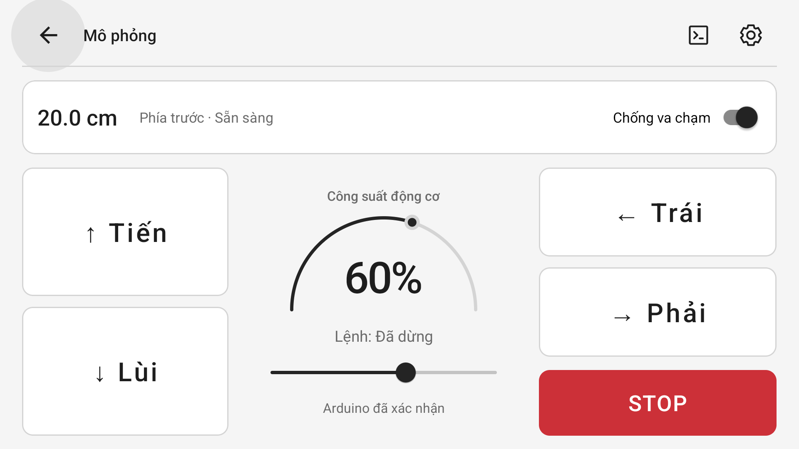

# Arduino Drive

Arduino Drive là ứng dụng Android điều khiển xe hai bánh qua Bluetooth Classic (HC-05). Arduino UNO R3 nhận lệnh, điều khiển hai động cơ qua L298N và dùng cảm biến VL53L0X phía trước để hỗ trợ tránh va chạm.

**Phiên bản hiện tại `v1.0.1`** · Android 6.0 trở lên

## Cài đặt và kết nối Bluetooth

1. Nhấn **TẢI APK MỚI NHẤT** và mở `Arduino-Drive-1.0.1.apk` trên điện thoại. Nếu Android yêu cầu, cho phép trình duyệt hoặc trình quản lý tệp cài ứng dụng từ nguồn này, rồi tắt quyền đó sau khi cài.
2. Nạp firmware cho UNO theo phần bên dưới. Kê bánh lên khỏi mặt đất trước khi cấp nguồn cho xe.
3. Bật Bluetooth, rồi ghép đôi HC-05 trong **Cài đặt Bluetooth** của điện thoại. Đóng các ứng dụng khác đang kết nối với module.
4. Mở **Arduino Drive** → **Bắt đầu**. Trong **Cài đặt** của ứng dụng, tắt **Mô phỏng khi mở Điều khiển** nếu đang bật. Quay về màn hình chính, mở **Điều khiển**, cấp quyền **Thiết bị ở gần** nếu được hỏi (Android 12 trở lên) và chọn HC-05 đã ghép đôi.
5. Sau khi kết nối, chờ **Arduino đã xác nhận** để chỉnh công suất. Giữ **Tiến**, **Lùi**, **Trái** hoặc **Phải** để lái. Nhả hết nút hướng hoặc nhấn **STOP** để dừng. Chỉnh về 0% cũng dừng và xóa hướng đang giữ. Khi tăng công suất trở lại, nhấn hướng mới để chạy.

Nếu ghép đôi được nhưng ứng dụng kết nối lỗi, xem [Hướng dẫn chẩn đoán Bluetooth](docs/BLUETOOTH_DIAGNOSTICS.md).

## Tính năng

- Lái xe qua Bluetooth Classic SPP, xem khoảng cách phía trước và trạng thái cảm biến.
- Chỉnh công suất PWM từ 0–100% ngay trên màn hình Điều khiển. Đồng hồ hiển thị mức PWM, không đo tốc độ bánh xe. Phiên Bluetooth mới gửi STOP và yêu cầu mức mặc định 60% với hỗ trợ chống va chạm bật.
- Khi đang giữ hướng, ứng dụng gửi lệnh duy trì mỗi 175 ms. Firmware dừng xe sau 500 ms kể từ lệnh lái hợp lệ cuối cùng. Các lệnh chỉnh công suất và cấu hình không gia hạn thời gian này.
- Bật hoặc tắt hỗ trợ giảm tốc và phanh theo khoảng cách. Mở **Cài đặt** từ màn hình Điều khiển để chỉnh thông số qua phiên Bluetooth đang dùng.
- Dùng chế độ mô phỏng để làm quen với giao diện khi không có xe. Ứng dụng hỗ trợ giao diện Sáng, Tối và Hệ thống.

## Ảnh giao diện

*Ảnh chụp trên trình giả lập Android trong chế độ Mô phỏng.*

## Phần cứng và đấu dây

Cần Arduino UNO R3, module L298N, module HC-05, module VL53L0X, hai động cơ DC, khung xe 2WD và nguồn phù hợp với động cơ. Các chân tín hiệu được khai báo trong [Config.h](include/Config.h).

| Thiết bị | Chân thiết bị | Nối tới |
| --- | --- | --- |
| L298N | ENA / ENB | UNO D3 / D6 (PWM) |
| L298N | IN1 / IN2 | UNO D8 / D9 |
| L298N | IN3 / IN4 | UNO D10 / D11 |
| L298N | OUT1 / OUT2 | Động cơ trái |
| L298N | OUT3 / OUT4 | Động cơ phải |
| HC-05 | TXD | UNO D4 (RX) |
| HC-05 | RXD | UNO D5 (TX), qua chia áp hoặc chuyển mức phù hợp |
| VL53L0X | SDA / SCL | UNO A4 / A5 (I²C) |
| HC-05, VL53L0X | VCC hoặc VIN | Nguồn phù hợp với từng module. Kiểm tra cả mức logic I²C của module VL53L0X. |
| UNO, L298N, HC-05, VL53L0X | GND | Chung GND với nguồn động cơ |

- Tắt nguồn UNO và nguồn động cơ trước khi đổi dây. Tháo **cả hai jumper ENA và ENB** trên L298N trước khi nối D3 và D6. Jumper chọn nguồn bộ ổn áp 5 V trên module có chức năng riêng.
- Cấp nguồn động cơ vào đầu nguồn động cơ của L298N. Không lấy nguồn động cơ từ chân 5 V của UNO.
- UART chế độ dữ liệu của HC-05 phải khớp firmware ở **38 400 baud**. Serial Monitor dùng **9 600 baud**.
- Firmware đặt `INVERT_LEFT=false` và `INVERT_RIGHT=true`. Kiểm tra chiều quay với bánh đã kê trước khi chạy.

## Chống va chạm

| Thông số | Mặc định | Khoảng chỉnh | Lệnh Bluetooth |
| --- | ---: | ---: | --- |
| Khoảng cách phanh | 40 cm | 10–150 cm | `D:n` + LF |
| Khoảng chờ giữa các lượt đọc VL53L0X | 60 ms | 40–200 ms | `I:n` + LF |
| Độ rộng vùng giảm tốc | 60 cm | 0–190 cm | `Z:n` + LF |
| Thời gian phanh điện | 30 ms | 1–60 ms | `E:n` + LF |

- Tổng khoảng cách phanh và độ rộng vùng giảm tốc tối đa **200 cm**. Khi đang tiến và tính năng bật, PWM giảm tuyến tính từ mức yêu cầu ở rìa ngoài vùng giảm tốc xuống gần 30% của mức đó ngay trên ngưỡng phanh. Đặt vùng giảm tốc về 0 cm để giữ hành vi phanh theo ngưỡng.
- Tại hoặc dưới ngưỡng, firmware phanh điện rồi ngắt EN của L298N. Mặc định trạng thái vật cản được xóa khi khoảng cách đạt ít nhất 45 cm. Sau khi phanh do vật cản, nhả hết nút lái hoặc nhấn STOP trước khi nhấn Tiến lại.
- Bốn thông số lưu trong RAM của UNO đến khi reset. Các thanh trượt trong Cài đặt gửi giá trị khi thả tay hoặc sau 250 ms nếu dùng bàn phím hoặc trợ năng. Khi thiếu phản hồi `CFG` (công suất) hoặc `SAFE` (chống va chạm), hoặc dữ liệu tương ứng đã quá 1 giây, thanh trượt liên quan bị khóa. Ứng dụng báo chưa xác nhận nếu sau 2 giây vẫn thiếu phản hồi khớp.
- Nếu VL53L0X lỗi, ứng dụng cảnh báo và hiển thị khoảng cách `--`. Xe vẫn nhận lệnh lái thủ công. Bảo vệ theo khoảng cách hoạt động trở lại khi có số đo hợp lệ.

Xem [giao thức Bluetooth](docs/PROTOCOL.md) để biết định dạng lệnh, trạng thái phản hồi và khả năng tương thích với firmware cũ.

## Nạp firmware và build Android

**Arduino IDE.** Cài thư viện **VL53L0X by Pololu** trong Library Manager. Mở [xe_dieu_khien.ino](xe_dieu_khien.ino), chọn **Arduino Uno** và cổng COM, rồi chọn **Verify** và **Upload**. Nếu đã cài Arduino CLI và core `arduino:avr`, có thể biên dịch từ thư mục gốc.

~~~powershell
arduino-cli lib install VL53L0X
arduino-cli compile --fqbn arduino:avr:uno .
~~~

Nếu AVR GCC không tìm thấy `VL53L0X.h` trong thư mục có dấu, chuyển thư viện sang đường dẫn chỉ dùng ký tự ASCII hoặc chỉ định vị trí bằng tùy chọn `--library`.

**Android.** Dùng JDK 17 hoặc 21, Android SDK Platform 35 và Build Tools 35.0.0. Trong thư mục `android`, chạy Gradle Wrapper.

~~~powershell
.\gradlew.bat assembleDebug testDebugUnitTest lintDebug
~~~

APK debug được tạo tại `android/app/build/outputs/apk/debug/app-debug.apk`. Khi đã có thiết bị hoặc trình giả lập Android kết nối, chạy `.\gradlew.bat connectedDebugAndroidTest` để kiểm thử giao diện và luồng ứng dụng.

## Kiểm thử và lưu ý an toàn

Bài kiểm thử Arduino trên máy tính chạy cùng sketch với GPIO, đồng hồ và cảm biến giả. Chạy từ thư mục gốc với `g++`.

~~~powershell
New-Item -ItemType Directory -Force output
g++ -std=c++11 -Wall -Wextra -pedantic -I tests/arduino tests/arduino/watchdog_test.cpp -o output/arduino-watchdog-test.exe
.\output\arduino-watchdog-test.exe
~~~

Tham khảo [ghi nhận kiểm thử các lần phát triển trước](docs/VERIFICATION.md). Kết quả kiểm thử trên máy tính và trình giả lập không xác nhận dòng phanh, quãng dừng hay độ ổn định Bluetooth trên xe thật.

- Kê bánh và thử từng hướng ở PWM thấp trước. Kiểm tra STOP, mức 0% và dừng khi mất lệnh. Khi tăng từ 0%, xe chỉ được chạy sau khi có lệnh hướng mới.
- Chỉ thử trên sàn trống sau khi đã kiểm tra dây và hướng quay. Dùng nguồn giới hạn dòng, đo dòng phanh, nhiệt độ L298N và quãng dừng thực. Chọn ngưỡng phanh đủ cho quãng phản ứng, quãng hãm và khoảng dự phòng. Xem mục 5.3 và bảng 5 trong [datasheet L298](https://www.st.com/resource/en/datasheet/l298.pdf).
- Xe chỉ đo khoảng cách phía trước. Giữ khu vực phía sau và hai bên trống khi lùi hoặc rẽ. Khi cảm biến báo lỗi, dừng để kiểm tra trước khi tiếp tục chạy.
